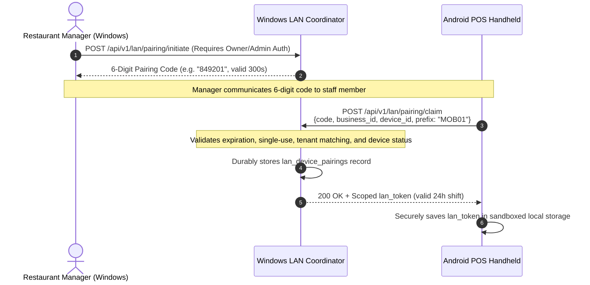

# Phase 11: Local Area Network (LAN) Coordination Architecture

## 1. Executive Summary & Objective

In restaurant environments, internet outages must not disrupt dining room service or bill generation. NextVisit implements **Phase 11: LAN Coordination** to enable multiple handheld POS terminals (e.g., Android smartphones and tablets) to discover, authenticate, and exchange permitted order updates directly with the Windows Desktop POS host acting as the **LAN Coordinator**—even when external broadband is completely down.

---

## 2. Physical & Network Topologies

```
                     ┌─────────────────────────────────────────┐
                     │          Cloud PostgreSQL + API         │
                     │          (NextVisit Cloud Backend)       │
                     └────────────────────▲────────────────────┘
                                          │
                         [INTERNET OUTAGE / DISCONNECTED]
                                          │
    ══════════════════════════════════════╪══════════════════════════════════════
    LOCAL RESTAURANT WI-FI / HOTSPOT (RFC 1918 Private LAN: 192.168.x.x / 10.x.x.x)
    ══════════════════════════════════════╪══════════════════════════════════════
                                          │
                       ┌──────────────────┴──────────────────┐
                       │   Windows Desktop POS Coordinator   │
                       │   - Host IP: 192.168.1.100:8001    │
                       │   - LAN Router: /api/v1/lan/*       │
                       │   - SQLite WAL / Local Store        │
                       └───────────▲───────────────▲─────────┘
                                   │               │
                 Pairing & Relay   │               │ Pairing & Relay
               (X-LAN-Token MOB01) │               │ (X-LAN-Token TAB01)
                                   │               │
             ┌─────────────────────┴───┐       ┌───┴─────────────────────┐
             │  Android Waiter Phone   │       │ Android Captain Tablet  │
             │  Device Prefix: MOB01   │       │ Device Prefix: TAB01    │
             │  Durable Local Outbox   │       │ Durable Local Outbox    │
             └─────────────────────────┘       └─────────────────────────┘
```

1. **Windows Host as LAN Coordinator**: The primary cashier/front-desk Windows desktop binds the LAN coordinator service to local private interfaces.
2. **Private Interface Isolation**: LAN endpoints (`/api/v1/lan/*`) strictly reject public, internet-routable IP addresses (RFC 1918 / RFC 3927 validation).
3. **Zero Secrets Leakage**: Cloud master database credentials, passwords, and cloud JWT bearer tokens are never transmitted to Android handhelds.

---

## 3. Authenticated Device Pairing Lifecycle

To prevent unauthorized access over guest Wi-Fi, handhelds must undergo short-lived, authorized pairing before relaying transactions.



### Pairing Security Controls
- **Short-Lived (300 seconds)**: Codes expire automatically after 5 minutes if unclaimed.
- **Single-Use**: Once claimed, the code is immediately invalidated; replay attempts return `400 Bad Request`.
- **Tenant Scoped**: Rejects cross-business claims with `403 Forbidden` if the device belongs to another tenant.
- **Revocation**: Business managers can immediately revoke any device via `POST /api/v1/lan/pairing/{device_id}/revoke`.
- **Anti-Spoofing**: Handheld requests verify that the payload `device_id` matches the token's authenticated device identity.

---

## 4. Permitted Operations & Durability Guarantees

### Permitted Operations
Only non-administrative order and billing operations may relay locally:
- `CREATE_ORDER`: Open table order creation with items, tax, and notes.
- `DIRECT_SALE`: Atomic order creation and immediate cash settlement.
- `SETTLE_ORDER`: Order settlement for cash or recorded offline card/UPI references.

*All other administrative, configuration, or user mutation operations are rejected with `400 Bad Request`.*

### Durability Invariant
1. The coordinator executes all incoming transactions within an ACID database transaction.
2. The database transaction is committed (`db.commit()`) **before** sending an HTTP 200 acknowledgement back to the handheld.
3. If the coordinator or power cuts out mid-transaction, no acknowledgement is sent. The handheld keeps the transaction in its durable SQLite outbox and retries upon reconnection.

### Dependency Safety (`CREATE_ORDER` before `SETTLE_ORDER`)
Batches containing both creation and settlement are topologically sorted on the coordinator to guarantee creation commits before settlement executes. If a standalone settlement references an uncommitted order, it defers with HTTP 503 instead of creating corrupted or orphaned payment records.

---

## 5. End-to-End Data Flow & Cloud Reconciliation

```
[Android Device A]           [Android Device B]          [Windows Coordinator]             [Cloud PostgreSQL]
       │                             │                            │                                │
       │ (Internet Outage Begins)    │                            │                                │
       │                             │                            │                                │
       │─── Relay CREATE_ORDER ─────┼───────────────────────────►│ (Committed to Local DB)         │
       │    (ORD-MOB01-000001)       │                            │                                │
       │◄── Acknowledged (200) ──────┼────────────────────────────│                                │
       │                             │                            │                                │
       │                             │─── Pull Updates ──────────►│                                │
       │                             │◄── Returns MOB01 Order ────│                                │
       │                             │    (Table Marked OCCUPIED) │                                │
       │                             │                            │                                │
       │                             │─── Relay SETTLE_ORDER ────►│ (Order Settled / Cash Paid)    │
       │                             │◄── Acknowledged (200) ─────│                                │
       │                             │                            │                                │
       │                             │                            │ (Internet Restored)            │
       │                             │                            │─── Batch Push All Tx ─────────►│
       │                             │                            │◄── Cloud Acknowledges 200 ─────│
```

### Scenario 1: Normal LAN Relay
1. Android Device A creates order `ORD-MOB01-000001`.
2. Device A detects cloud offline, pushes batch to Windows Coordinator (`POST /api/v1/lan/relay/push`).
3. Windows Coordinator validates `X-LAN-Token`, records transaction, commits to database, and returns `SUCCESS`.
4. Device A marks the local outbox item `COMMITTED`.
5. Android Device B calls `GET /api/v1/lan/relay/pull` and immediately observes Table 1 occupied with Device A's order items.

### Scenario 2: Coordinator or Wi-Fi Router Downtime
1. If the Windows host or local Wi-Fi drops, Android devices receive connection timeouts.
2. Devices retain all items in their durable local SQLite `client_outbox` in `PENDING` state with bounded exponential backoff.
3. Zero data is dropped. As soon as the Windows host or router recovers, outbox workers automatically resume flushing.

### Scenario 3: Cloud Synchronization on Internet Restoration
1. When broadband connectivity returns, the Windows Desktop POS sync worker pushes all accumulated transactions to `POST /api/v1/sync/push`.
2. Cloud PostgreSQL validates idempotency hashes. Any order already synced is acknowledged with `ALREADY_COMMITTED` without duplicating orders, payments, or customer visits.
3. If an Android device regains 4G/5G mobile data before the Windows host regains internet, it can push its outbox directly to the cloud. When the Windows host later syncs, cloud idempotency guarantees zero duplicates.

---

## 6. Conflict Resolution Matrix

| Scenario | Risk | System Defense & Outcome |
| :--- | :--- | :--- |
| **Concurrent Orders** | Two devices create orders at the exact same millisecond. | Unique device prefixes (`MOB01`, `TAB01`) produce distinct monotonic order numbers (`ORD-MOB01-000001` vs `ORD-TAB01-000001`). Zero collision. |
| **Duplicate Delivery** | Network drops before handheld receives 200 response; handheld retries push. | Coordinator checks `sync_transactions` for `(business_id, client_tx_id)`. Idempotent match returns `ALREADY_COMMITTED` with original order data. No duplicate orders/visits. |
| **Payload Tampering** | Handheld resends same `client_tx_id` with modified total or items. | SHA-256 payload hash check detects discrepancy and rejects with `409 CONFLICT`. Transaction flagged for operator inspection. |
| **Device Spoofing** | Paired Device A attempts to submit orders claiming Device B's identity. | Coordinator cross-checks token's bound `device_id` against request body. Rejects with `403 Forbidden: Device spoofing rejected`. |
| **Coordinator Power Loss** | Coordinator PC loses power during active shift. | SQLite/PostgreSQL WAL journaling prevents database corruption. Handhelds retain outbox items and resume seamlessly once coordinator reboots. |

---

## 7. Manual Testing Runbook with Two Android Devices and Windows Host

### Prerequisites
- Windows Host running NextVisit backend on port 8001.
- Two Android POS handheld devices (Device A and Device B) connected to the same local Wi-Fi or Windows Wi-Fi Hotspot.

### Step 1: Discover Coordinator
1. On Windows, determine local IP: run `ipconfig` (e.g. `192.168.1.100`).
2. On Android Device A, open browser or NextVisit app and navigate to:
   `http://192.168.1.100:8001/api/v1/lan/status`
3. Verify response returns `200 OK` with `coordinator_name` and server UTC timestamp.

### Step 2: Authenticate & Pair Devices
1. On Windows POS (logged in as Owner/Admin), initiate pairing:
   - Call `POST /api/v1/lan/pairing/initiate`.
   - Record the 6-digit code (e.g., `582910`).
2. On Android Device A (Waiter Phone):
   - Submit claim with prefix `MOB01` and code `582910` to `POST /api/v1/lan/pairing/claim`.
   - Confirm receipt of `lan_token`.
3. On Windows POS, generate a second code for Device B (Captain Tablet).
4. On Android Device B:
   - Submit claim with prefix `TAB01` to `POST /api/v1/lan/pairing/claim`.
   - Confirm receipt of `lan_token`.

### Step 3: Test Concurrent Offline Order Relay
1. Disconnect the WAN/Internet cable from the router (or disable WAN uplink on hotspot).
2. On Device A, create and submit order for Table 1:
   - Verify order number generated is `ORD-MOB01-000001`.
   - Confirm outbox item status transitions to `COMMITTED` via LAN relay.
3. Concurrently on Device B, create order for Table 2:
   - Verify order number generated is `ORD-TAB01-000001`.
   - Confirm outbox item transitions to `COMMITTED`.
4. On Device B, query `GET /api/v1/lan/relay/pull`:
   - Verify Device B displays Table 1 as occupied with Device A's order items.

### Step 4: Test Coordinator Interruption & Recovery
1. Terminate the backend on Windows (simulating power outage).
2. On Device A, submit a settlement for cash:
   - Observe transaction queues in local outbox with `RETRY` backoff.
   - Zero orders or payments are lost.
3. Restart backend on Windows.
4. Device A automatically reconnects and relays settlement.
5. Verify order is marked `SERVED` with recorded cash payment.
