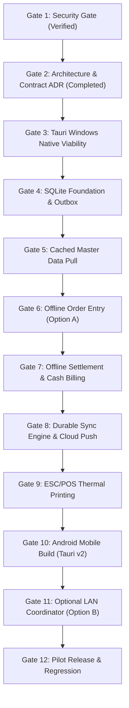

# Architecture Decision Record (ADR): Offline POS & Data Synchronization Contract

**Status:** APPROVED (Phase 2 Architectural Baseline)  
**Date:** 2026-10-17  
**Author / Auditor:** Antigravity (Advanced Agentic Architecture & Security Audit)  
**Target Repository:** `NextVisit` (`C:\Users\hp\Desktop\Major Project\Nextvisit`)  

---

## 1. Executive Summary & Core Recommendation

NextVisit requires a production-grade restaurant Point of Sale (POS) that can operate reliably under erratic network conditions: total internet outages, unstable local Wi-Fi, application restarts, and multi-terminal concurrency.

### Core Recommendation: Staged Offline Architecture
1. **MVP (Phase 3 through Phase 8): Option A — Independent Offline Replicas per Device.**
   - Every POS terminal (Windows Desktop running Tauri + SQLite and future Android handhelds) maintains an independent local SQLite database and durable transactional outbox.
   - Terminals can independently create orders, print kitchen order tickets (KOT), take cash/offline recorded payments, print receipts, and advance local table states.
   - When internet is restored, terminals push queued transactions and pull incremental master data directly to/from the FastAPI + PostgreSQL cloud backend.
   - **Crucial Operational Reality:** Devices do *not* magically share offline orders with each other during an active internet outage in Option A. Each device only sees its own local orders while disconnected.
2. **Future Expansion (Phase 11): Option B — Windows Desktop as Local LAN Coordinator.**
   - Once Option A reaches stability, the Windows Desktop POS terminal will optionally run an embedded local HTTP/mDNS daemon.
   - Android handheld terminals on the same local Wi-Fi router will direct order entry to the local Windows coordinator before syncing to the cloud. If the local coordinator or router fails, Android handhelds fall back gracefully to Option A (independent local persistence).

---

## 2. Confirmed vs. Unverified Repository Baseline

Based on live source inspection and test executions:

| Subsystem | Confirmed Present in Source | Unverified / Absent / Stub Only | Source Reference |
| :--- | :--- | :--- | :--- |
| **Backend Framework** | FastAPI + SQLAlchemy 2.0 + Pydantic v2 + PostgreSQL + Alembic. | — | `Backend/app/main.py`, `pyproject.toml` |
| **Backend Device Management** | `POST /api/v1/devices`, `GET /api/v1/devices`, `PATCH`, `DELETE`. RBAC restricted to `OWNER` / `ADMIN`. Device prefixes validated (`^[A-Z0-9]{1,10}$`) and uniquely indexed per business. | Token-based device registration / secret device authentication keys (currently uses User JWT). | `Backend/app/api/v1/devices/router.py`, `Backend/app/services/client_device_service.py` |
| **Backend Sync Engine** | `POST /api/v1/sync/push` (atomic execution, SHA-256 idempotency hashing, rollback on failure, `ORD-{PREFIX}-` prefix enforcement, batch limit <= 100). `GET /api/v1/sync/pull` (delta sync via `since` timestamp for menu, dining areas, settings). | Hard delete tombstones, server-side cursor pagination, offline conflict resolution queue, customer pull sync. | `Backend/app/api/v1/sync/router.py`, `Backend/app/services/sync_service.py` |
| **Frontend Framework** | Vite v8.1.5 + React 19 + TypeScript SPA + React Router + TanStack Query. | — | `Frontend/package.json`, `Frontend/src/App.tsx` |
| **Tauri Desktop Shell** | Tauri v2.12.4 configuration files and minimal Rust entrypoint (`src-tauri/src/lib.rs`). | Working local SQLite database, native print plugins, functional Windows installer/binary. | `Frontend/src-tauri/Cargo.toml`, `Frontend/src-tauri/src/lib.rs` |
| **Frontend Runtime Bridge** | Runtime detection (`isTauri()` in `Frontend/src/lib/desktop.ts`). | Offline durable outbox, SQLite connection bridge, background sync worker. | `Frontend/src/lib/desktop.ts` |
| **Order Security & QR** | Order detail & add-item endpoints enforce staff business isolation or verified visit tokens (`X-Visit-Token`). Customer auto-detect safely handles anonymous calls. | — | `Backend/app/api/v1/orders/router.py`, `Frontend/src/lib/orders-api.ts`, `Frontend/src/components/qr-order-view.tsx` |

---

## 3. Phase 1 Security-Gate Audit & Evidence Status

The Phase 1 security audit items specified in the Master Execution Plan were inspected against current source code and verified with 29 automated tests:

### 3.1 Device Registration & Revocation
- **Status:** **CONFIRMED & COVERED BY AUTOMATED TESTS.**
- **Source Evidence:**
  - `Backend/app/api/v1/devices/router.py` lines 36-40 & 98-102: strictly validates `current_user.role.upper() in ["OWNER", "ADMIN"]`. Waiters/staff receive `403 FORBIDDEN`.
  - `Backend/app/services/client_device_service.py` lines 22-34: enforces uppercase regex `^[A-Z0-9]{1,10}$` and database uniqueness per business (`uq_client_devices_biz_prefix`).
  - Revocation: `ClientDeviceUpdate(is_active=False)` or `delete_device` instantly deactivates the device.
- **Verification:** Covered by `tests/test_idempotency_and_sync.py::test_device_registration_and_prefix_uniqueness` and `test_non_owner_device_registration_forbidden`.

### 3.2 Sync Push / Pull Device Ownership & Tenant Isolation
- **Status:** **CONFIRMED & COVERED BY AUTOMATED TESTS.**
- **Source Evidence:**
  - `Backend/app/services/sync_service.py` lines 52-57: `self.device_repo.get_by_id_and_business(data.device_id, current_user.business_id)`. If the device ID belongs to another tenant or `is_active is False`, it raises `403 FORBIDDEN`.
  - Spoofing protection: `sync_service.py` lines 181 & 199 unconditionally overwrite `order_data.device_id = device.id` from the verified session, blocking any client payload spoofing.
- **Verification:** Covered by `tests/test_idempotency_and_sync.py::test_unauthorized_device_push_rejected`, `test_device_spoofing_prevented_in_order_creation`, and `test_cross_business_tenant_isolation`.

### 3.3 Transaction Idempotency & Replay Protection
- **Status:** **CONFIRMED & COVERED BY AUTOMATED TESTS.**
- **Source Evidence:**
  - `Backend/app/services/sync_service.py` lines 45-50 & 76-102: calculates canonical SHA-256 payload hash including `operation_type`.
  - If `client_tx_id` exists with identical hash: returns `ALREADY_COMMITTED` with the exact historical response payload without re-executing business logic.
  - If `client_tx_id` is replayed with a different payload or different operation: rejects with `409 CONFLICT`.
  - Concurrency: `test_concurrent_duplicate_requests` executes multithreaded concurrent pushes; row locking and database constraints prevent double commitments.

### 3.4 Payload Validation & Batch Limits
- **Status:** **CONFIRMED & COVERED BY AUTOMATED TESTS.**
- **Source Evidence:**
  - `Backend/app/schemas/sync.py` line 15: `transactions: list[SyncTransactionItem] = Field(..., min_length=1, max_length=100)`. Pydantic rejects batches over 100 items with `ValidationError`.
  - Covered by `test_sync_push_max_limit_enforced`.

### 3.5 QR Guest Access Integration
- **Status:** **CONFIRMED & COVERED BY AUTOMATED TESTS.**
- **Source Evidence:**
  - Secured endpoints: `Backend/app/api/v1/orders/router.py` lines 160-171 & 207-219.
  - Corrective frontend fix: `Frontend/src/lib/orders-api.ts` lines 314-361 forwards `X-Visit-Token`.
  - `Frontend/src/components/qr-order-view.tsx` passes `storedVisitToken` and disables polling when token is absent.
  - Tested by `tests/test_order_security.py` (13 passed tests).

### 3.6 Remaining Security / Sync Gaps (Actionable for Target Contract)
1. **Hard Delete Tombstones (Moderate Gap):** `sync_pull` filters on `updated_at >= since`. If a menu item or table is hard-deleted from PostgreSQL, the client pull does not receive a tombstone.
   - *Architecture Resolution:* The data model must transition to soft deletes (`is_active = False` or `deleted_at`) so delta queries naturally capture deletions.
2. **Device Authentication vs. User JWT (Design Enhancement):** Currently, sync push/pull requires an active User Bearer JWT (`current_user`). If staff JWT expires during a multi-day internet outage, the sync worker cannot push offline transactions until a user logs in online.
   - *Architecture Resolution:* Add client device mutual authentication (device secret API key or refresh token) in the target contract.

---

## 4. Architecture Options Comparison & Failure Matrix

| Failure / Concurrency Scenario | Option A: Independent Replicas (Chosen MVP) | Option B: Windows LAN Coordinator | Option C: Cloud-Only Web POS (Current) |
| :--- | :--- | :--- | :--- |
| **Internet Fails, Router/LAN Works** | **Operational.** Each terminal creates local orders, prints KOT/bills locally, saves to local SQLite. Cross-terminal visibility paused until sync. | **Operational.** Android devices send orders to Windows POS over Wi-Fi. All terminals see active tables and bills. | **Complete Outage.** Application cannot load, submit orders, or settle payments. |
| **Router & Internet Both Fail** | **Operational.** Terminals continue working independently on local battery/device storage. | **Degraded.** Android devices cannot reach Windows coordinator. System halts unless terminals fallback to Option A. | **Complete Outage.** |
| **Windows Desktop Restarts / Dies** | **Zero Impact on Mobile.** Android handhelds continue taking local orders. | **Total System Halts.** Android handhelds lose coordinator, table locking fails, orders block. | **No Impact.** (Depends on cloud). |
| **Simultaneous Order Creation on 2 Devices** | **No Conflict.** Devices use unique prefixes: `ORD-D1-000101` vs `ORD-TAB1-000201`. Unique UUIDs prevent ID collisions. | **Coordinated.** Windows assigns sequential numbers. | **Cloud Sequential.** Serialized via DB row locks. |
| **Two Devices Edit Same Order** | **Last-Write-Wins or Conflict Flag.** If an order was opened before outage, conflicting item updates sync sequentially. Cloud flags conflict for operator review. | **Immediate Lock.** Windows coordinator rejects second edit or merges items in real time. | **Optimistic Locking / LWW.** |
| **Two Devices Settle Same Order** | **Prevented by Cloud Rule.** First settlement marks order `SERVED`/`PAID`. Second settlement attempt returns `400/409 Order already settled`. Local outbox flags for cashier review. | **Prevented in Real-Time.** Windows POS rejects second settlement locally. | **Prevented in Real-Time.** |
| **Reconnects After Hours / Days** | **Safe.** Idempotent outbox flushes in chronological order. Batch limits (100 items) chunk the backlog. | **Safe.** Windows coordinator flushes single aggregated transaction log. | **N/A.** |
| **User JWT Expires While Offline** | **Risk.** If sync worker depends solely on user JWT, push halts until re-authenticated. Handled via stored device credentials. | **Risk.** Coordinator cannot push to cloud without credentials. | **User forced to login page.** |
| **Payment Gateway Unreachable** | **Cash / Offline Claim Mode.** Terminal records cash or offline payment intent. Unverified online UPI/Card is never marked confirmed. | **Cash / Offline Claim Mode.** | **Payment Fails.** |

### MVP Recommendation
**Adopt Option A for the MVP.** Option A delivers immediate resilience against the most common restaurant disaster: sudden fiber/broadband cut. It introduces zero complex networking requirements (no static IPs, no firewall exceptions, no mDNS discovery bugs). Option B is scheduled for Phase 11 as a non-breaking additive layer.

---

## 5. Target Architecture Specification

```
+-----------------------------------------------------------------------------------------+
|                                    TAURI DESKTOP POS                                    |
|                                                                                         |
|  +-----------------------------------------------------------------------------------+  |
|  |                             React 19 / Vite UI Layer                              |  |
|  |   - POS Cashier View         - KOT Order Entry         - Bill Settlement Modal    |  |
|  |   - Table Map Status         - Pending Sync Indicator  - Conflict Resolution View |  |
|  +------------------------------------------+----------------------------------------+  |
|                                             | TanStack Query / Repository Pattern       |
|  +------------------------------------------v----------------------------------------+  |
|  |                              Local Client Service Layer                           |  |
|  |   - Mode Resolver: ONLINE_FIRST vs OFFLINE_DURABLE                                |  |
|  |   - ID Generator: Prefix-based Order Numbers (ORD-{PREFIX}-{SEQ}) + v4 UUIDs      |  |
|  |   - Local Recalculator: GST, Discounts, Subtotals (mirrors Backend OrderService) |  |
|  +---------------------+------------------------------------+------------------------+  |
|                        |                                    |                           |
|  +---------------------v--------------------+  +------------v------------------------+  |
|  |          Tauri IPC Bridge (Rust)         |  |         Native Hardware Bridge      |  |
|  |   - SQLite Plugin (tauri-plugin-sql)     |  |   - ESC/POS Thermal Printer Bridge  |  |
|  |   - Durable Outbox Queue Manager         |  |   - USB / LAN Socket / Bluetooth    |  |
|  |   - Background Periodic Sync Worker      |  |   - Raw byte stream / Fallback Print|  |
|  +---------------------+--------------------+  +-------------------------------------+  |
|                        |                                                                |
|  +---------------------v-------------------------------------------------------------+  |
|  |                              Local SQLite Embedded DB                             |  |
|  |   - app_migrations          - client_outbox (Durable queue)                       |  |
|  |   - cached_menu_categories  - cached_menu_items                                   |  |
|  |   - cached_dining_areas     - cached_tables                                       |  |
|  |   - local_orders            - local_order_items                                   |  |
|  |   - local_payments          - sync_cursor_state                                   |  |
|  +---------------------+-------------------------------------------------------------+  |
+------------------------|----------------------------------------------------------------+
                         |
                         | HTTPS / REST (When Internet Available)
                         | Bearer Auth + Device Mutual Headers (X-Device-Id, X-Device-Key)
                         |
+------------------------v----------------------------------------------------------------+
|                         FASTAPI + POSTGRESQL CLOUD BACKEND                              |
|                                                                                         |
|  +-----------------------------------------------------------------------------------+  |
|  |                                  API V1 Routers                                   |  |
|  |   - /api/v1/devices (Registration, Keys, Revocation)                              |  |
|  |   - /api/v1/sync/push (Batch processing, Idempotency registry, prefix validation) |  |
|  |   - /api/v1/sync/pull (Delta sync for menu, tables, settings)                     |  |
|  |   - /api/v1/orders (Standard online orders, QR guest ordering)                    |  |
|  +------------------------------------------+----------------------------------------+  |
|                                             |                                           |
|  +------------------------------------------v----------------------------------------+  |
|  |                             Core Services & Validation                            |  |
|  |   - SyncService              - OrderService            - ClientDeviceService      |  |
|  +------------------------------------------+----------------------------------------+  |
|                                             |                                           |
|  +------------------------------------------v----------------------------------------+  |
|  |                            PostgreSQL Cloud Source of Truth                       |  |
|  |   - businesses               - client_devices          - sync_transactions        |  |
|  |   - menu_categories/items    - dining_areas/tables     - orders / order_items     |  |
|  +-----------------------------------------------------------------------------------+  |
+-----------------------------------------------------------------------------------------+
```

---

## 6. Proposed API & Shared Data Contract

### 6.1 Status of Backend Support per Field

| Contract Area | Proposed Field / Semantic | Backend Status | Required Future Changes |
| :--- | :--- | :--- | :--- |
| **Device Identity** | `device_id` (UUID) | **Supported** | None |
| | `device_prefix` (String, 1-10 uppercase) | **Supported** | None |
| | `device_api_secret` (Hashed Secret Key) | **Future Enhancement** | Add `api_secret_hash` column to `client_devices` table for autonomous offline sync without user JWT renewal. |
| **Sync Push** | `client_tx_id` (UUID) | **Supported** | None |
| | `operation_type` (`CREATE_ORDER`, `SETTLE_ORDER`, `DIRECT_SALE`) | **Supported** | Partially supported. Add `APPEND_ITEMS` and `CANCEL_ORDER`. |
| | `payload_hash` (Canonical SHA-256) | **Supported** | None |
| | `batch_size` (<= 100 items) | **Supported** | None |
| **Order Numbering**| `ORD-{device_prefix}-{seq:06d}` | **Supported** | Enforced by `sync_service.py` line 182. |
| **Client IDs** | `client_order_id` (UUID), `client_item_id` (UUID) | **Supported** | Columns present in `orders` and `order_items`. |
| **Delta Pull** | `since` (ISO 8601 Timestamp) | **Supported** | Add cursor pagination if delta > 500 items. |
| | Deletion Tombstones (`deleted_ids`) | **Future Enhancement** | Transition menu/tables to soft delete (`is_active = False` or `deleted_at`) and return `tombstones` list in `SyncPullResponse`. |

### 6.2 Canonical Transaction Envelope (Outbox Payload)

```typescript
export interface ClientOutboxTransaction {
  client_tx_id: string; // UUID v4 generated locally
  device_id: string;    // Registered device UUID
  operation_type: "DIRECT_SALE" | "CREATE_ORDER" | "SETTLE_ORDER" | "APPEND_ITEMS";
  created_at: string;   // ISO 8601 UTC
  status: "PENDING" | "SENDING" | "COMMITTED" | "FAILED" | "CONFLICT";
  retry_count: number;
  last_error: string | null;
  payload: Record<string, any>;
}
```

### 6.3 Payment Truth Contract
- **Cash Payment:**
  - Can be settled offline.
  - Recorded with status: `PAYMENT_STATUS = "RECORDED_OFFLINE"`.
  - When synced to cloud, backend converts to `PAID`.
- **UPI / Card Payment:**
  - Cannot be verified without network.
  - Terminal can only record an **offline reference note** (e.g. manual transaction ID from physical POS EDC card machine).
  - Terminal must **never** claim an unverified online payment was confirmed.
  - Synced to cloud as `PENDING_VERIFICATION` unless accompanied by a verified gateway transaction token.

---

## 7. Local Data & SQLite Recovery Design

### 7.1 SQLite Schema Outline
The local SQLite database will reside in the application data directory (`%APPDATA%/NextVisit/pos_local.db`) managed via `tauri-plugin-sql`.

1. **`app_meta`**:
   - `key TEXT PRIMARY KEY`, `value TEXT NOT NULL`, `updated_at DATETIME`.
   - Stores `schema_version`, `device_id`, `business_id`, `device_prefix`, `last_sync_timestamp`.
2. **`cached_master_menu`**:
   - `id TEXT PRIMARY KEY`, `category_id TEXT`, `name TEXT`, `price REAL`, `tax_rate REAL`, `is_available INTEGER`, `updated_at DATETIME`.
3. **`cached_dining_tables`**:
   - `id TEXT PRIMARY KEY`, `area_id TEXT`, `table_name TEXT`, `status TEXT`, `current_order_id TEXT`, `updated_at DATETIME`.
4. **`local_orders`**:
   - `id TEXT PRIMARY KEY` (UUID v4),
   - `order_number TEXT UNIQUE NOT NULL` (`ORD-{PREFIX}-{seq}`),
   - `table_id TEXT NOT NULL`,
   - `customer_id TEXT`,
   - `status TEXT NOT NULL` (`OPEN`, `SERVED`, `CANCELLED`),
   - `subtotal REAL NOT NULL`,
   - `tax_amount REAL NOT NULL`,
   - `discount_amount REAL NOT NULL`,
   - `total_amount REAL NOT NULL`,
   - `sync_status TEXT NOT NULL` (`PENDING`, `SYNCED`, `CONFLICT`),
   - `created_at DATETIME NOT NULL`,
   - `updated_at DATETIME NOT NULL`.
5. **`local_order_items`**:
   - `id TEXT PRIMARY KEY` (UUID v4),
   - `order_id TEXT NOT NULL REFERENCES local_orders(id) ON DELETE CASCADE`,
   - `menu_item_id TEXT`,
   - `item_name TEXT NOT NULL`,
   - `unit_price REAL NOT NULL`,
   - `quantity INTEGER NOT NULL`,
   - `tax_rate REAL NOT NULL`,
   - `discount REAL NOT NULL`,
   - `subtotal REAL NOT NULL`,
   - `notes TEXT`.
6. **`client_outbox`**:
   - `client_tx_id TEXT PRIMARY KEY` (UUID v4),
   - `operation_type TEXT NOT NULL`,
   - `payload_json TEXT NOT NULL`,
   - `payload_hash TEXT NOT NULL`,
   - `status TEXT NOT NULL` (`PENDING`, `SENDING`, `COMMITTED`, `CONFLICT`, `FAILED`),
   - `retry_count INTEGER DEFAULT 0`,
   - `last_error TEXT`,
   - `created_at DATETIME NOT NULL`.

### 7.2 Durability & Corruption Recovery
- **WAL Mode:** Enforce `PRAGMA journal_mode = WAL; PRAGMA synchronous = NORMAL;`.
  - Ensures writes survive sudden power cuts without database corruption.
- **Atomic Operations:** Local order creation + outbox queuing occurs in a single SQLite transaction (`BEGIN IMMEDIATE ... COMMIT`).
- **Corruption Recovery:**
  - Automated daily backup: `pos_local.db.bak` generated at startup.
  - If SQLite reports `SQLITE_CORRUPT`, the application renames the corrupt file to `pos_local_corrupt_<timestamp>.db`, initializes a fresh database, pulls master data from the cloud, and writes an error incident log for diagnostic retrieval.

---

## 8. Printer & Mobile Decisions

### 8.1 Thermal Receipt & KOT Printing
- **Protocols Supported:**
  1. Standard ESC/POS command stream (code page 437 / WPC1252, raster bit-image for logo, cut command `GS V 0`).
  2. Fallback: Browser Print (`window.print()`) remains fully supported for all platforms without native printer drivers.
- **Connection Interfaces:**
  - **USB:** Direct raw printer device communication via Tauri native Windows print spooler API (`winspool.drv` or `RawPrint`).
  - **LAN / Network:** Direct raw TCP socket to port 9100.
  - **Bluetooth:** Deferred to mobile / Android handheld phase.
- **Architecture Abstraction:**
  ```typescript
  interface PrinterDriver {
    connect(config: PrinterConfig): Promise<boolean>;
    printRaw(bytes: Uint8Array): Promise<boolean>;
    getStatus(): Promise<PrinterStatus>;
  }
  ```

### 8.2 Android Strategy
- **Viable Path:**
  - The frontend is already a standard responsive Vite + React 19 SPA.
  - Tauri v2 officially supports Android as a mobile target (`tauri android init`), sharing the exact same frontend codebase, IPC commands, and Rust SQLite plugin.
  - No separate mobile framework (such as React Native or Flutter) is required.
  - Android handhelds will consume the identical shared sync contracts defined in this document.

---

## 9. Master Roadmap & Acceptance Gates

The implementation roadmap follows an ordered progression:



### Phase Details

1. **Phase 1: Security Gate Remediation & Validation (COMPLETED)**
   - *Outcome:* Order auth, customer auto-detect, and sync tenant checks verified with 29 automated tests.
2. **Phase 2: Architecture Decision & Data Contract (CURRENT - ADR DELIVERED)**
   - *Deliverable:* This specification document (`docs/architecture/offline-pos-architecture.md`).
3. **Phase 3: Tauri Desktop Shell Viability**
   - *Objective:* Validate Windows Tauri v2 build pipeline, verify Rust toolchain, test packaged base URL routing.
   - *Scope:* `Frontend/src-tauri/`, `Frontend/src/lib/desktop.ts`.
4. **Phase 4: SQLite Persistence & Migration Foundation**
   - *Objective:* Integrate `tauri-plugin-sql`, define migration runner, establish WAL mode and corruption recovery.
   - *Scope:* `Frontend/src-tauri/`, `Frontend/src/lib/db/`.
5. **Phase 5: Cached Master Data & Pull Sync**
   - *Objective:* Cache menu categories, items, dining areas, and tables from `GET /api/v1/sync/pull` into local SQLite.
   - *Scope:* `Frontend/src/lib/sync/`, `Frontend/src/features/`.
6. **Phase 6: Offline Order Creation (Option A)**
   - *Objective:* Allow cashier to create orders and add items directly into local SQLite with `ORD-{PREFIX}-{seq}` order numbers while disconnected.
   - *Scope:* `Frontend/src/lib/orders-api.ts`, `Frontend/src/components/pos/`.
7. **Phase 7: Offline Settlement & Cash Lifecycle**
   - *Objective:* Settle orders offline for cash, generate local visits, update local table status to available.
   - *Scope:* `Frontend/src/components/orders/`, `Frontend/src/lib/orders-api.ts`.
8. **Phase 8: Durable Sync Engine & Push Worker**
   - *Objective:* Background worker that flushes `client_outbox` to `POST /api/v1/sync/push` upon network restoration.
   - *Scope:* `Frontend/src/lib/sync/sync-worker.ts`.
9. **Phase 9: ESC/POS Thermal Printer Integration**
   - *Objective:* Direct raw printing to USB / Network 80mm/58mm thermal receipt printers with browser print fallback.
   - *Scope:* `Frontend/src-tauri/src/printer.rs`, `Frontend/src/lib/printer/`.
10. **Phase 10: Android App Packaging (Tauri v2 Mobile)**
    - *Objective:* Compile Android APK using shared Vite code and Tauri mobile runner.
11. **Phase 11: Optional LAN Coordinator (Option B)**
    - *Objective:* Local mDNS discovery and HTTP bridge on Windows Desktop for local multi-terminal coordination during outages.
12. **Phase 12: Pilot Testing & Cross-Module Regression**
    - *Objective:* Rigorous end-to-end regression testing across restaurant, salon, school, CRM, and admin modules.

---

## 10. Non-Regression Invariant

All subsequent implementation phases must strictly adhere to the following invariants:
- **Zero Schema Disruption:** Existing PostgreSQL database models and migrations must not be altered except through explicitly approved additive migrations.
- **Module Isolation:** Modules including Salon, School, CRM, Festival Campaigns, BI Analytics, and SuperAdmin must not be modified or imported into offline-specific handlers.
- **Byte-for-Byte Preservation:** Non-code scratch artifacts (`Backend/scratch/test_executive_pdf.pdf` and `Backend/scratch/test_layout.pdf`) must remain untouched.
- **Security Prerequisite:** No offline transaction can bypass tenant verification or device prefix boundaries on the backend.
